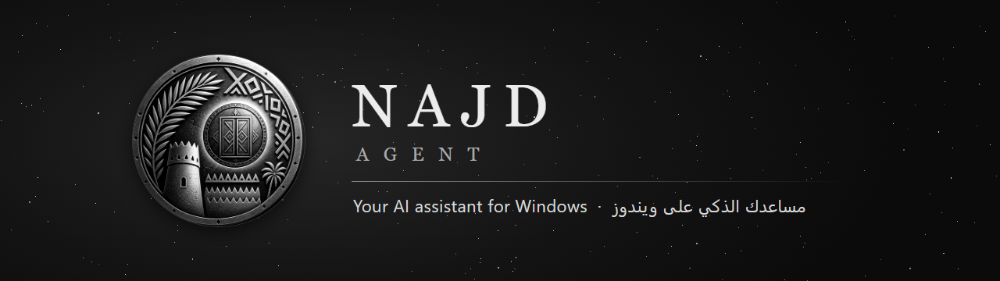
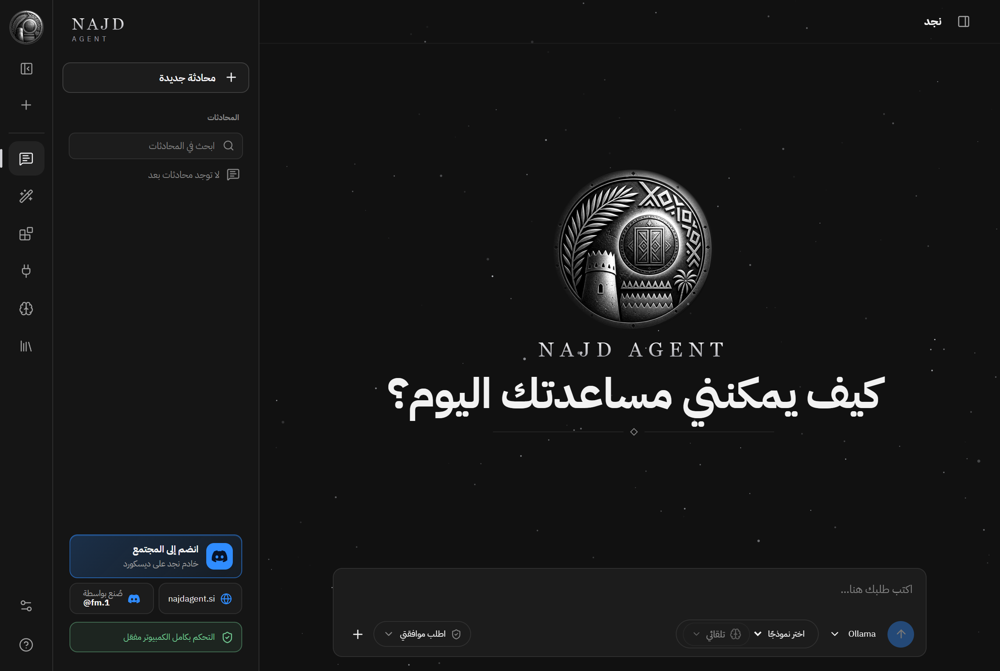
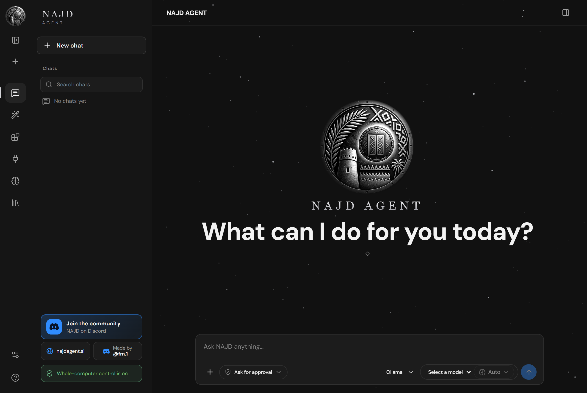

<p align="center">
  
</p>

<h1 align="center">NAJD AGENT</h1>

<p align="center">
  <a href="https://najdagent.si"><b>Website</b></a> ·
  <a href="https://github.com/ibrahimI-T/najd/releases/latest"><b>Download</b></a> ·
  <a href="https://discord.gg/QAbYVEdcE"><b>Discord</b></a>
</p>

<p align="center">
  <a href="https://github.com/ibrahimI-T/najd/releases/latest"></a>
  <a href="LICENSE"></a>
  <a href="https://discord.gg/QAbYVEdcE"></a>
  <a href="https://najdagent.si"></a>
  <br>
  
  
  
  
</p>

<p align="center"><b>An AI assistant for Windows that actually does the work.</b><br>
It speaks Arabic and English, uses the model you choose, and finishes real tasks on your computer: files, apps, the browser, documents and the web. You decide what it may do.</p>

<p align="center" dir="rtl"><b>نجد: مساعد ذكي لويندوز ينجز المهام فعلًا.</b> يتكلم العربية والإنجليزية، ويستخدم النموذج اللي تختاره، ويشتغل على جهازك بموافقتك.</p>

<p align="center">
  
  
</p>

## Why NAJD

- **Your model, your choice.** Use your ChatGPT plan, an API key (OpenAI, Claude, Gemini and others) or a local Ollama model, with adjustable thinking depth.
- **Works on your computer.** Opens any installed app, reads and operates windows, runs commands and Python, and creates and edits files in the folders you allow.
- **Browses for you.** The NAJD extension for Chrome and Edge lets it search, open and read pages in its own tab. Typing and clicking ask for your approval.
- **Makes documents and designs.** Word, Excel and PowerPoint files and charts with the built-in Office and design pack.
- **Signs in for you, safely.** Authorize accounts once; passwords stay in Windows protected storage and never reach the model.
- **Connects your services.** MCP servers such as Canva, fal, Replicate and ElevenLabs, with sign-in or API-key templates.
- **Remembers and knows.** Memory across chats, and knowledge bases (company policies, manuals) that it searches and cites.
- **From your phone.** Pair a Telegram bot and send NAJD tasks while you are away.
- **You stay in control.** Ask every step, approve safe steps, or full access; an activity timeline shows every step. Passwords, payments and verification codes always stay with you.

## Install

1. Download `NAJD-AGENT-Setup.exe` from the [latest release](https://github.com/ibrahimI-T/najd/releases/latest) (Windows 10 or 11, 64-bit).
2. Run it and follow the steps. Windows may show an unknown-publisher notice until the installer carries a publisher certificate.
3. On first launch, connect a model in **Settings > Models**, then ask for something.

NAJD checks for new versions on its own, shows a notice and a Windows notification, and keeps your chats and settings when it updates.

## Privacy and security

Your chats stay on your computer. Your messages and files go only to the provider or service you choose, and NAJD collects no telemetry. The automatic update check asks GitHub for the latest version number and sends nothing about you or your chats. Keys and passwords are kept with Windows protection and never written to logs. See [SECURITY.md](SECURITY.md) to report a vulnerability privately. **Settings > About > Save diagnostics file** creates a redacted file you can share when you need help.

## Build from source

Requirements: Windows, Node.js 24 and npm. In PowerShell:

```powershell
npm.cmd ci
npm.cmd run setup:electron
npm.cmd run desktop
```

Checks: `npm.cmd test`, `npm.cmd run build`, `npm.cmd run smoke:desktop`. Tests use isolated temporary data and fake credentials.

More: [architecture](docs/ARCHITECTURE.md), [capabilities](docs/CAPABILITIES.md), [development guide](docs/DEVELOPMENT.md), [browser extension](browser-extension/README.md), [installer](docs/INSTALLER.md).

## Built on open source

NAJD builds on [OpenClaw](https://github.com/openclaw/openclaw), [Hermes Agent](https://github.com/NousResearch/hermes-agent) and other open-source projects. Their licenses and authorship are kept in the app (**Settings > General > About NAJD and licenses**) and in [docs/THIRD-PARTY-LICENSES.md](docs/THIRD-PARTY-LICENSES.md).

## Community

Questions, ideas and bug reports: join the [NAJD Discord](https://discord.gg/QAbYVEdcE) or open an issue. If NAJD helps you, a star on this repository is appreciated.

---

<p align="center">Made by <b>FM</b> · Discord <b>@fm.1</b> · <a href="https://najdagent.si">najdagent.si</a><br>Released under the <a href="LICENSE">MIT License</a>.</p>
