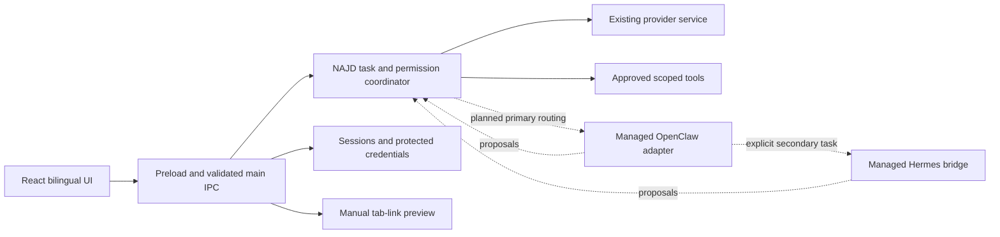

# Architecture and integration ownership

Phase 03 design, 2026-10-14. Requirements: USER_REQUIREMENTS.md; versions/notices: THIRD-PARTY-LICENSES.md; contracts: SPEC-engine-adapters.md. Design is not runtime acceptance.

Current implementation through Phase 10 (2026-10-15): OpenClaw has an authenticated
managed Gateway; explicit Hermes planning runs through NAJD's bounded provider
broker with upstream tools disabled. Skills registry and source metadata discovery
plus a fixed native MCP manager have sender-checked APIs and working bilingual
management UI. Source presence never grants execution. Durable memory remains
Phase 11. The Phase 03 baseline/target diagram below is retained as design history;
current verified behavior and remaining gates are in PROGRESS.md / TEST_MATRIX.md.

## Existing implementation

main.cjs creates Electron's window/services and validates main-frame IPC senders. React/TypeScript uses preload.cjs; nodeIntegration is false, sandbox/contextIsolation true. najd-core.cjs captures tasks/model/effort and enforces approvals/cancellation; provider-service.cjs owns the 13 routes. Production connectors return text; explicit read commands use file-tools.cjs and per-read folder approval.

session-store.cjs owns bounded atomic conversation JSON; credential-store.cjs/chatgpt-store.cjs own OS-protected credentials and inference proof; activity-log.cjs only accepts declared metadata. Browser-link is a separate off-by-default manual selected-tab preview. runtime-manager.cjs supervises a child but is not imported by main.cjs. Neither upstream currently executes as a NAJD engine.

## Target owners (D-034)

| Concern | Authoritative owner | Upstream boundary |
|---|---|---|
| Identity, UI, settings and cost consent | NAJD | One user-facing product |
| Task intents/leases, approvals, cancellation, effect journal and verification | NAJD coordinator | One captured engine per task; no parallel effects or silent fallback |
| Primary runtime/agent transport and live engine context | OpenClaw behind NAJD adapter | Genuine pinned source/runtime, no direct renderer RPC |
| Secondary planning/execution | Hermes bridge | Explicit secondary lease; no independent orchestration loop dispatching effects |
| Device/file/browser effects | NAJD tool adapter | Engine proposals are untrusted; default-deny upstream tools until approval interception is proven |
| Accounts, models, credentials and billing | Existing NAJD provider service | Private bounded broker enforces captured provider/account/model/budget; never import personal tokens |
| Durable conversations, journal and shared memory | NAJD storage | Map engine sessions to canonical NAJD IDs; upstream contexts are private derived stores, never shared writers |
| Skills/MCP provenance, dependencies and scopes | NAJD registry | Format adapters; executable extensions need validated consent |
| Scheduling/channels | NAJD optional coordinator | Upstream cron/channels off by default; no duplicate scheduler |
| Binaries/config/lifecycle/packaging | NAJD runtime services | Exact pins/hashes, separate directories, authenticated local/stdio transport |

Preserve today's direct-provider core during gated adapter development. A selected engine fails honestly if unavailable; never fall back automatically. After real Gateway proof, expose truthful status and route supported task types incrementally. Record customized upstream scopes/patches and original authorship in SOURCE-REUSE.md before use.

## Canonical memory ownership (Phase 11, 2026-10-16)

NAJD main is the sole writer of najd-data/sessions.json, memory.json, personality.json
and learning/{preference,experience}{,-pending}.json. These stores are separate
from encrypted credentials, engine profiles and diagnostics. memory-store owns
bounded atomic version-1 note records; personality owns its bounded profile;
learning owns a bounded version-2 policy with read-only version-1 compatibility.
React can only invoke sender-checked fixed-schema IPC. Engines receive disposable
selected-provider context snapshots, never direct file-write access. Local literal
capture and keyword retrieval invoke no model; optional shared context consumes
ordinary input tokens. Retention is explicit deletion (no silent eviction), with
validated native-picker backups and fail-closed preservation. See SPEC-memory.md.

## Process and data boundaries

- Prefer a stock Node satisfying OpenClaw's exact constraint for the native proof. Electron's numerically compatible embedded Node has a different native-addon ABI; this alone does not validate OpenClaw. Do not require WSL or replatform Electron without evidence and an owner-visible tradeoff.
- Provision isolated Python 3.14 with pinned Hermes dependencies. Never start the standalone Hermes desktop binary or attach to its private profile.
- Runtime data: userData/najd-data/engines/<engine>, explicitly set OPENCLAW_STATE_DIR/OPENCLAW_CONFIG_PATH/HERMES_HOME. Installation hashes/nonsecret metadata remain separate. Engines cannot write canonical NAJD stores.
- Bridge tokens stay in main/safeStorage and process-private channels; never command arguments, renderer or logs. Valid authenticated instance/protocol plus a benign request establishes readiness; HTTP 200 alone is liveness.
- Gateway channels/cron/remote nodes and uncontrolled tools start disabled. Hermes tools remain disabled until NAJD enforcement is proven. Upstream built-ins do not imply authorization.
- Until a tested task-bound inference broker exists, engines cannot borrow existing protected accounts or claim subscription parity. Every broker request validates task lease/account/model/budget.
- Bound/redact logs; untrusted text never grants permissions. Test instrumentation belongs only in temporary fixtures.

## Failure and rollback

| Failure | Required behavior |
|---|---|
| Missing/incompatible payload | Accurate install/compatibility error; explicit existing direct-provider route stays available |
| Occupied port/unrelated responder | Refuse attachment unless explicitly configured and authenticated |
| Startup failure/timeout | Bound wait, stop owned process tree, stable error, explicit retry |
| Engine crash | Invalidate leases/instance; reconcile journal; no uncertain-effect replay |
| Provider failure/lost OS key | Preserve unreadable record; explicit recovery; no alternate paid request |
| Cancel/window close | Stop further dispatch; await tree exit; retain UNKNOWN_EFFECT when needed |
| Upgrade/schema failure | Preserve old payload/state and recovery checkpoint; no destructive automatic rollback |

Build order remains master phases: baseline -> real Gateway -> Windows boundary -> UX/providers -> Hermes -> skills/MCP -> memory/task recovery -> optional integrations -> security/installer/E2E -> authorized publication. No P0 concern has two authoritative owners; unimplemented enforcement remains a phase gate.
